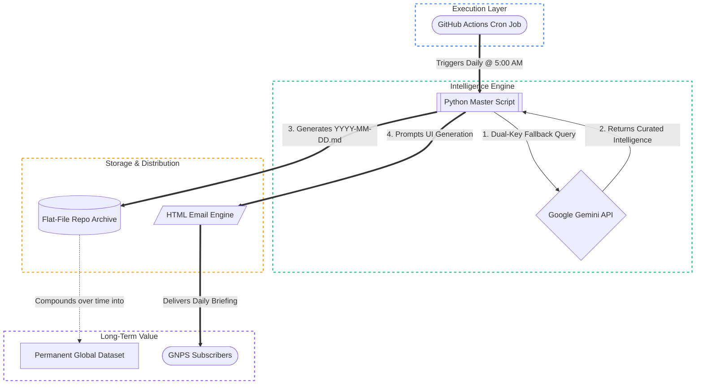

# The Gemini Chronicle Agent (TGCA)


> A source-first daily news collector and intelligence archive. TGCA gathers regional and topic-level headlines, deduplicates them, uses Gemini with Google Search grounding for synthesis when available, and preserves a publisher-linked source ledger.

Runs daily via GitHub Actions **->** RSS collection **->** Gemini grounded synthesis (when available) **->** Markdown + source ledger **->** local HTML email **->** Git commit **->** email delivery.

---

## The Origin Story

Every useful system starts with friction. This one started with my mornings.

*   **Phase 1: The Infinite Scroll:** I am deeply interested in global events, but staying informed meant jumping across dozens of sources every morning. It was fragmented, inefficient, and forgettable. By the next day, most of what I read was gone.
*   **Phase 2: The Manual Prompt:** To fix this, I built a structured deep-search prompt and ran it through Gemini daily. The output was concise and high-signal. But this created a new problem: digital clutter. Chat logs piled up, organization broke down, and busy days meant skipping the process entirely.
*   **Phase 3: The Broken Archive:** I tried manually saving outputs into dated files. That failed quickly. Manual effort did not scale, file organization became messy, and commits were inconsistent. The solution became another chore.
*   **Phase 4: The Breakthrough:** The turning point was a simple question: *What if this system ran entirely on its own and archived itself?* 

That led to discovering GitHub Actions as a serverless execution layer. From there, I built a fully automated pipeline that runs daily without intervention, queries Gemini for real-time intelligence, generates a clean Markdown report, commits it directly to this repository, and sends a formatted HTML briefing via email. 

Now, the system runs automatically, and the archive grows every day.

---

## System Architecture

TGCA uses GitHub as a complete execution and storage environment.


### 1. The Pulse (GitHub Actions)
A scheduled YAML workflow acts as a cron job, spinning up a fresh Linux environment daily.

### 2. The Brain (Gemini API)
A custom Python script that:
*   Authenticates securely using environment secrets.
*   Uses bounded key/model fallback and stops retrying hard project-quota failures. Keys from the same Google Cloud project share project quota.
*   Performs live web-informed queries.
*   Generates a structured global intelligence report.

### 3. The Ledger (Flat-File Archive)
*   Automatically creates year-based directories (e.g., `/2026/`).
*   Stores each report identically as `YYYY-MM-DD.md`.
*   Maintains a clean chronological dataset with zero database overhead.

### 4. The Designer (HTML Generation)
The Markdown report is rendered into a responsive HTML newsletter locally. This avoids a third Gemini request and lets the email still be produced during Gemini quota outages.

---

## Example Output
```text
TGCA/
├── 2026/
│   ├── 2026-03-27.md
│   ├── 2026-03-28.md
│   └── 2026-03-29.md
└── main.py
```
*Each file contains a structured daily intelligence brief covering global events, tech trends, and economic shifts.*

---

## Long-Term Vision

This system is designed to accumulate value over time.

*   **In 1 Year:** Approximately 365 structured reports forming a complete reference of global events.
*   **In 3-5 Years:** A clean, massive dataset that can be used for trend analysis, pattern tracking, and historical queries.
*   **In 10-20 Years:** A compact archive representing a long-term record of global developments and AI-generated summaries.

All data is stored purely in Markdown, ensuring ultimate portability and long-term accessibility across any future technology.

---

## Setup and Deployment

### 1. Add Repository Secrets
Navigate to **Settings** -> **Secrets and variables** -> **Actions** and add your credentials:
*   `GEMINI_API_KEY`
*   `GEMINI_API_KEY_2` (Optional Fallback)
*   `EMAIL_USERNAME`
*   `EMAIL_PASSWORD` (App Password)

### 2. Install Dependencies
Ensure your workflow includes the required SDKs:
```bash
pip install google-genai
```

### 3. Configure the Cron Job
Edit your workflow file to set your preferred delivery schedule (Note: GitHub Actions uses UTC time):
```yaml
# .github/workflows/main.yml
on:
  schedule:
    - cron: '30 01 * * *' # Runs at 7:00 AM IST
```

---

## Conclusion

This project began as a way to reduce noise and organize information. It evolved into an enterprise-grade system that removes manual effort, produces consistent output, and builds long-term value automatically.

Instead of consuming information reactively, this pipeline curates, stores, and compounds it over time. 

**Fork the repository, add your API keys, and let the system run.**

---
*Built with Python, GitHub Actions, and Google Gemini.*


---

## News collection and quota resilience

TGCA now collects multiple regional and topic-level Google News RSS feeds (Americas, Europe, Asia-Pacific, Africa, Gulf/MENA, India, Telangana, Andhra Pradesh, technology, science, health, security, energy, markets, infrastructure and migration). Headlines are deduplicated while retaining publisher links and publication timestamps. A source ledger is appended to each Markdown report so the collected evidence remains auditable.

Gemini is asked to find additional important stories, attribute factual claims to publishers, cross-check consequential developments and avoid generic filler. A structural check rejects reports with missing or thin sections and insufficient clickable citations.

When Gemini returns a hard `429 RESOURCE_EXHAUSTED` quota/billing error, TGCA does not wait through repeated long retries. It writes a clearly labelled RSS-only archive instead of inventing missing news. If both Gemini and RSS collection fail, the workflow stops rather than publishing an empty report.

**Coverage note:** RSS and Search grounding improve discovery but cannot establish 99% coverage of all news published worldwide. The source ledger documents what TGCA collected; it is not a complete census. Gemini quotas are project-scoped, so two API keys from the same Google Cloud project share its quota.
